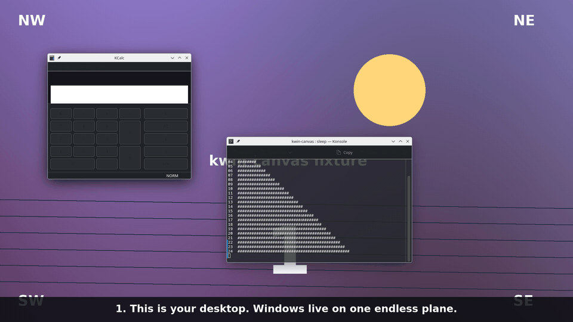
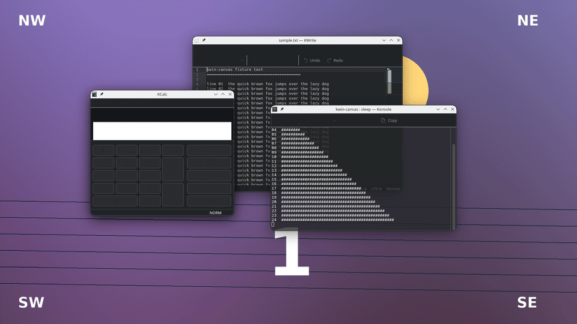

# kwin-canvas

[](https://gitlab.com/ritwick7/kwin-canvas/-/pipelines)
[](LICENSES/)
[](https://api.reuse.software/info/gitlab.com/ritwick7/kwin-canvas)
[](https://www.ritwickverma.dev/)
[](https://buycovfefefor.ritwickverma.dev/)

**An infinite canvas for KDE Plasma.** Every window lives on one endless plane.
Step out to see all of it, fly anywhere, step back in - and what you arranged
is real window geometry, not a picture of it.



- **One plane, no workspaces to juggle.** Park windows anywhere; the screen is
  just where you are looking. Off-screen windows are still ordinary KWin
  windows.
- **Fly, don't search.** Double-click a window to fly to it, hold the side
  button to turn the world into a map, `Ctrl+1..9` to bookmark a view and
  `Alt+1..9` to fly back.
- **Feels physical.** Spring camera, flick-to-pan inertia, windows you can throw,
  edges that snap like magnets, a soft float on pinned windows.
- **Stays out of the way.** With the canvas closed nothing of it runs: games and
  fullscreen apps get KWin's native path. An idle open canvas costs about
  nothing.
- **Plays with KDE.** Activities, KWin tiles, maximize and the title bar's pin
  stay in sync with the plane.
- **Built on KWin's public scripting API.** No compositor patches; an optional
  C++ plugin makes windows interactive while the canvas is open.

### Quick start

```bash
git clone https://gitlab.com/ritwick7/kwin-canvas.git && cd kwin-canvas
make deps                 # what is missing, and the pacman line to fix it
./configure.sh install    # effect, wallpaper, applets, CLI into ~/.local; effect on
```

Log out and back in, then press **Meta+Ctrl+Alt+Space** (or push a screen
corner) to step out. Full install notes, the optional plugin and every key are
below.

The full history is about 100 MB, mostly earlier versions of the golden screenshots;
`git clone --depth 1` brings 17 MB, and `git fetch --unshallow` the rest later.

<details>
<summary>The longer demo: the hover's glow, the clusters' web, the switcher</summary>



</details>

## How it works

An infinite canvas for KDE Plasma, built on KWin's public scripting API. No
patches, no forked compositor, no plugin against private headers.

Windows live on one unbounded plane, and there are two places to be on it.
A **location** is an activity's viewport onto the plane at 1:1 with the
canvas closed: stock Plasma, nothing of ours running, so games and
fullscreen apps get KWin's native path (direct scanout, no extra
composition). Every window is an ordinary KWin window at an ordinary
position, some of them off-screen, and KWin handles input, popups, XWayland
and focus exactly as it always does. The **overworld** is the open canvas:
every window drawn live on the plane, the ground, each activity as a group
of **monitor frames** (outlined rectangles, one per output in the layout KDE
knows, tagged with the activity and output names, its wallpaper inside) and
the toolbar. With the pass-through plugin loaded the windows in the
overworld are live too: the pointer over a window's client area goes to the
window and every key goes to the focused window.

One chord steps out and back in. Stepping out opens the overworld at the
current viewport at 1:1, so it looks like the desktop until you move.
Stepping in enters the location under the screen centre; if that is another
activity's frame you switch to it, and the viewport is written where the
camera is. Drag windows into a frame or drag an activity's frames over a
cluster of windows, step in, and that is what the real screens show in that
activity, written back as plain window geometry. Switching activities in a
location switches viewport, and dragging a window into another activity's
frame moves it to that activity. Virtual desktops stay what they are: the
canvas shows the current desktop's windows.

The ground plane is the reference for all of this. A grid with coordinate
labels scrolls under the windows when you pan at 1:1 and scales with them when
you zoom out, so the plane has landmarks and the zoom has something to anchor.
Beyond the monitor frames the plane keeps the wallpaper's presence
(`Backdrop=wallpaper`, the default): on the desks it is exact, and across the
rest of the view the same wallpaper is drawn once per output, blurred
(`BackdropBlur`, 48 px) and dimmed (`BackdropDim`, 0.45) with the grid over
it, so stepping out looks like the desktop dissolving into a haze rather than
a wallpaper repeating in tiles or a grid fading into nothing. The haze is the
desktop window itself, live - a slideshow or a picture of the day keeps going
in it - and it costs nothing while the camera sits at 1:1 on the desk, where
it would be invisible anyway. `Backdrop=grid` is the old plane.

> Proven in a nested KWin 6.8 session and on a live Plasma 6.8 desktop,
> with over a hundred scenarios and golden screenshots - but still a fork's
> work in flight, not an upstream release.

## Parts

| Package | Type | What it does |
|---|---|---|
| `effect/` | KWin/Effect (QML) | The canvas: snapshot, ground, thumbnails, pan, zoom, pick, commit |
| `wallpaper/` | Plasma/Wallpaper | The ground at 1:1, offset by the last committed pan |
| `shared/Ground.qml` | copied into both | One renderer for the ground so both views match |
| `plugin/` | KWin plugin (C++, optional) | Pass-through: while the canvas is open, clicks, drags, the wheel and keys reach the real windows |
| `tools/kwin-canvas` | CLI (bash) | Step in, cancel, open or toggle from a terminal or a VT; status; doctor and perf, which only read |
| `applet/` | Plasma/Applet | A panel button that fires the Toggle Canvas chord |
| `applet-decor/` | Plasma/Applet | The decor applet: the focused window's glyphs in the panel, in the pill's language |
| `decoration/` | KWin/Decoration | The Canvas window frame: no title bar, the glass pill on the focused window's edge |
| `dev/nest.sh` | harness | Nested KWin with its own D-Bus and config, driven from the shell |

## Install

Full walkthrough in [docs/install.md](docs/install.md). On Arch, upstream's
latest release is on the [AUR](https://aur.archlinux.org/packages/kwin-canvas)
(0.4.0; none of this fork's work is in it yet):

```bash
yay -S kwin-canvas      # or paru, or makepkg from the AUR clone
```

then enable **Canvas** in System Settings → Desktop Effects. The pass-through
plugin is its own package, `kwin-canvas-passthrough`, built against your
KWin; rebuild it after a KWin upgrade. From upstream's release tarballs with
no checkout:

```bash
kpackagetool6 --type KWin/Effect --install kwin-canvas-0.4.0.kwineffect.tar.gz
kpackagetool6 --type Plasma/Wallpaper --install kwin-canvas-ground-0.4.0.tar.gz
kpackagetool6 --type Plasma/Applet --install kwin-canvas-toggle-0.4.0.tar.gz
```

then enable **Canvas** in System Settings → Desktop Effects. From a checkout:

```bash
./configure.sh install      # the packages into ~/.local/share, the CLI into ~/.local/bin, effect turned on
./configure.sh status       # installed, enabled, loaded
./configure.sh uninstall    # off and removed
```

Every `configure.sh` command is one Makefile target (`make install enable`,
`make status`, `make uninstall`); `make` alone lists the rest, including
`install-system` with `DESTDIR` for distro packaging, `pkgbuild` for the
AUR skeletons, and `plugin` to build the pass-through plugin from a checkout.

Then pick **Canvas Ground** as the desktop wallpaper in Desktop Settings, and
disable the stock **Zoom** effect if it owns Meta+wheel.

## Recommended KDE setup

The canvas works with KDE's defaults, and none of this is required. It is the setup the
author runs and tests against (Plasma 6.8 on Wayland, two monitors, one virtual desktop), and
each row says what the setting does for the canvas.

| Where | Setting | Why |
|---|---|---|
| Window Behavior → Focus | **Focus follows mouse**, delay focus by **150 ms** | Resting on a window hands it the input; the delay keeps a pass-over from stealing focus. |
| Window Behavior → Focus | **Raise on hover**, delayed **300 ms**; **Click raises active window** off | The canvas raises the window an auto fly lands on itself, so this only has to agree with it. |
| Screen Edges | The four corners set to **Canvas**; in the Canvas settings, *View when a screen edge or corner opens it* set to **fit** | A corner push shows every window and frame, fitted to the monitor the pointer is on; push again to leave. The wheel on the bare wallpaper opens it too. |
| Virtual Desktops | **One** desktop | The plane takes the place of desktops; activities are the separate desks on it. |
| Shortcuts | Unbind KDE's **Walk Through Windows** (Alt+Tab) | The canvas's switcher uses Meta+Tab and Alt+Tab. `kwin-canvas doctor` lists any key that two actions share. |
| Desktop Effects | Stock **Zoom** off | It owns Meta+wheel, Meta+= and Meta+-. |
| Animations | Global speed at the **default**, not faster or slower | The slide, the camera and the fades follow it (below 1 is faster); at a quarter of the default KDE's own slide effects blink. |
| Panels | **Auto hide** or **Dodge windows** | An always-visible panel reserves screen space, and KWin recalculates its work area whenever the panel changes; it then pulls windows parked outside the monitors back in. The canvas puts them back, but a panel that reserves no space never triggers it. |
| Window Decorations | **Canvas**, with buttons *close, on all desktops, keep above, maximize, minimize* | The pill shows the same five as the panel applet; *on all desktops* is the float. |
| Window Rules | Picture-in-picture, a lyrics window or a monitor: **Keep above** and **All desktops** | A window that is on all desktops floats: it stays on the screen while you fly. |

`kwin-canvas setup` walks through these: it shows each setting that differs, with what it does for
the canvas, and changes it only when you answer `y` (`kwin-canvas setup --check` lists them and changes
nothing). A shortcut that two actions share is reported for you to rebind. The same, by hand:

```bash
kwriteconfig6 --file kwinrc --group Windows --key FocusPolicy FocusFollowsMouse
kwriteconfig6 --file kwinrc --group Windows --key DelayFocusInterval 150
kwriteconfig6 --file kwinrc --group Windows --key AutoRaise true
kwriteconfig6 --file kwinrc --group Windows --key AutoRaiseInterval 300
kwriteconfig6 --file kwinrc --group Windows --key ClickRaise false
kwriteconfig6 --file kwinrc --group Effect-kwin-canvas --key BorderActivate 1,3,5,7
kwriteconfig6 --file kwinrc --group Effect-kwin-canvas --key BorderZoom fit
kwriteconfig6 --file kdeglobals --group KDE --key AnimationDurationFactor 1
qdbus6 org.kde.KWin /KWin reconfigure
```

`BorderActivate` numbers the screen edges from 0 at the top, clockwise to 7 at the top left,
so `1,3,5,7` is the four corners. The pass-through plugin is built for one exact KWin
version: after a KWin update the grasp over windows and the pill's buttons stop working until
it is rebuilt and installed again, and `kwin-canvas doctor` says so.

Also running in the author's session, and not tested against the canvas beyond what the
test suite covers: KZones, Remember Window Positions and a blur effect. A tile (KZones, a KWin
tile, a maximized window) moves as a whole room on the plane.

## Use

| Key | At 1:1 (in a location) | Canvas open (the overworld) |
|---|---|---|
| Meta+Ctrl+Alt+Space | step out: the overworld opens at the current viewport, 1:1 | step in: enter the location under the screen centre; another activity's frame switches to that activity |
| Meta+Ctrl+Space | jump home | jump home |
| Meta+Ctrl+F (or `/` when the canvas has the keys) | find a window: the overview opens fitted | type words of a window's title or app: the others dim, the camera brings the match to the middle; Tab steps the matches, Enter flies into the chosen one, Esc ends the search |
| pan chords (no default; bind under Shortcuts → KWin) | slide the desktop half a screen that way | move the camera |
| three-finger touchpad swipe | the desktop follows the fingers, then settles half a screen that way | |
| drag on ground, Space+drag, or middle-drag | | pan |
| hold a button and drag (`PanHold`, empty by default; the right button and the side buttons are there if you want one), or the middle button | | a portal into the canvas: drag the ground to pan, drag a window (its client area too) to move it on the plane — the app under it never sees the press. The middle button pans from anywhere, windows and tags included |
| hold the navigate button or the middle button at a screen edge (`EdgePan`) | | the canvas keeps panning that way, faster the deeper the pointer is in the band, until it leaves the band or the button is let go |
| hold a window at a screen edge with a portal button down | | the canvas pans and the window comes along, staying under the pointer while it travels over the desk — a drag-and-drop edge scroll, so a window can be pushed into a frame that is off the screen |
| wheel over the ground | | zoom at the cursor, springing to the step with the point under the cursor pinned (`SmoothZoom`); the wheel over a client area is the window's |
| flick a pan and let go (`PanInertia`) | | the plane keeps moving the way the hand was moving, slowing to a stop; a drag that pauses before letting go lands exactly where it was put |
| push the pointer into a screen edge or corner (Screen Edges; `BorderZoom`) | | step out around that screen at `BorderZoom` (0.8 by default, `fit`, or `1` for the desktop exactly as it was), so the desks around it show; the chord enters the point the push came from. With `BorderSlide` on, a push instead pans the plane one step toward the pushed side — a slide at 1:1, a camera step in the open canvas — so the borders are a route around the plane rather than a door in and out of it |
| pointer over a window's client area | | the window's, with the plugin: click, drag, wheel, and a click raises |
| keys | | the focused window's, with the plugin; the canvas keys below apply without it |
| drag a window's title bar | | move it on the plane, with a trail and a lean that settle when the hand stops (`WindowPhysics`; drawn only, the committed geometry is exact) |
| drag a frame's tag or edge | | move that activity's frames, all together, and its windows with them so nothing changes on screen (`FramesCarryWindows`, on by default; off moves the frames over the windows) |
| drag a window's edge or corner | | resize it, live |
| eye on a frame tag | | hide or show that frame: a hidden frame is not drawn and takes no windows, for an activity that lives on one monitor |
| + on a frame tag | | add an activity |
| trash on a frame tag | | remove that activity (never the last) |
| click a window's title bar | | select it; Shift+click adds, Ctrl+click toggles, Shift+drag on the ground selects by rectangle |
| drag a selected window's title bar | | move the whole selection, geometry kept; drop it in a frame and step in to move them all to that activity |
| right-click a window's title bar | | arrange the selection: horizontally, vertically, tile, grid (rows × columns), cascade; send to an activity or to the plane |
| toolbar toggles | | snap to edges, corners, grid while dragging or resizing (grid step and snap distance are settings) |
| double-click a window's title bar | | enter that window's location, focused, with the window wholly on screen; a window in another activity's frame takes you to that activity. `FocusTarget` sets where the viewport goes: `smart` (default) and of the placements that keep the window wholly in view takes the one that leaves the most of the desk's other windows in view too, so a window alone lands centred; `centre` brings the window's centre to the screen centre whatever that pushes off it; `window` keeps the point you clicked under the pointer at 1:1, shifted the least it can be if that would cut the window off; `desktop` leaves a frame where it is and only centres a window outside every frame. All of them slide the frames, their windows and the wallpaper together and write nothing. Every step in is a flight: the camera springs to the location at 1:1, the chrome fades, and the write lands on arrival — nothing on screen jumps |
| double-click a frame | | enter that location, its activity current |
| Ctrl+double-click a frame, or click its swatch in the toolbar | | zoom to that activity |
| Shift+double-click a window outside every frame | | new activity centred on it, window moved there |
| Enter | | enter the location under the screen centre (the toolbar's **Enter**); with a window selected, enter that window instead, focused |
| Esc | | fly back to where you were, nothing moved (the toolbar's **Cancel**); the window's own key when pass-through is live |
| Home | | look through the current activity's frames |
| 0 | | canvas origin |
| F | | zoom to fit |
| Tab / Shift+Tab | | step the selection through the windows, wrapping; the camera follows to keep the chosen window in view |
| WASD | | pan the camera one step |
| click a window, or rest the pointer on one | | the camera pans the least that brings it wholly into view |
| hold MB4 and tap MB5 (`SwapButton`) | on the desktop: the location becomes the canvas | tour the clusters: the camera and the focus land on the next cluster's most-recently-focused window, smart-placed so the windows around it come into view; release opens the location there |
| hold MB4, wheel out, release | on the desktop: the location becomes the canvas | the grasp's keyhole: the world itself is the map as the camera zooms out - the windows shrink live into its sheets, the cluster chips float on the plane, a click on a window flies it to 1:1, and the hint strip names the release; zoomed in, the release commits the location instead |
| [ / ] | | fly the camera to the next / previous cluster of nearby windows, in reading order on the plane |
| the switcher chord (`SwitcherShortcut`, Meta+Tab, and `SwitcherAltShortcut`, Alt+Tab - bind them over KWin's Tabbox) | | Meta+Tab fits the whole plane, Alt+Tab the cluster the eye is on; Tab and Shift+Tab step the highlighted window, the release or Enter enters it, Esc steps back out |
| Float (a window's arrange menu) | | the window keeps its coordinates on the plane - only the hand moves them - and when the camera pushes it partly off the screen its picture floats at the edge, bouncing off it with real physics; move the camera back and the picture is the window again. The same flag as "on all desktops", so it follows you across virtual desktops too, and anything that sets that flag floats the window: a rule, an app, or a script that restores it (Remember Window Positions does, for a window it saw pinned once). If a window never follows the canvas, check that first |

Activating a window from the task manager - or anything else that focuses it,
Alt-Tab included - **slides the desktop to it through the canvas**: the plane
glides until the window is wholly on screen, centred, and a focused window is
never left hanging off an edge. Everything that pulls focus on a window flies
to it.

**Pass-through** is the optional binary plugin, `kwin-canvas-passthrough`,
and it is live whenever the canvas is open - but it waits for the aim:
the first pointer motion after the overworld opens settles it, and until
then the wheel and the clicks belong to the canvas, so the wheel right
after opening zooms the canvas instead of scrolling whatever window
happens to sit under the pointer. Once settled, the pointer over a
window's client area goes to that window, so clicks land, drags select
or move things inside it, the wheel scrolls it, and a click raises it;
every key goes to the focused window, Esc included. Title bars and edges
- wearing the open hand - frames, tags, the ground and the toolbar stay
the canvas's: a drag on a title bar moves the window on the plane, a
drag on the ground pans, the wheel over the ground zooms. Clicking a
window's client area no longer selects it; select from the title bar.
The plugin is built against the installed KWin, and KWin loads it only
for that exact version; without it the overworld is a navigation view
and the canvas keys, Esc included, are its own. `make plugin-status`
says which. The `Passthrough` setting turns it off.

Panning in a location is a **slide**: the effect opens for a moment at 1:1
with no frames or toolbar, this activity's windows glide, and their new
positions are written once when it settles. No window changes activity, and
you never leave the location. The desktop's wallpaper rides along inside
its frame, and the ground shows beyond it. The step, the duration and the
swipe's finger count are settings. KWin's own three-finger swipes switch
virtual desktops and its four-finger swipes open Overview; a matching count
fires both, so pick a count you do not use elsewhere, or set it to 0.

When the chord does not reach the open canvas, `kwin-canvas exit` from a
terminal or a virtual terminal steps into the location under the screen
centre; `cancel`, `open`, `toggle` and `status` are the other subcommands.

It finds the session bus at the user's runtime directory, so it works from
a VT with no display. The **Canvas** panel applet (`applet/`) is a button
that fires the Toggle Canvas chord.

**Troubleshooting: `kwin-canvas doctor`.** When something does not behave, run
`kwin-canvas doctor` first. It only reads, so it is safe to run mid-game, and
prints one OK, WARN or FAIL line per check: whether each installed part (the
effect, the ground wallpaper, both applets, the window decoration, the CLI and
the plugin) is the same as the repo's, whether the running session is older than
the files it loaded (`main.qml` and the plugin need a relogin, `ui.qml` a
`make hot`), whether a global shortcut is bound to a Canvas action and another
action at once, whether KDE's Zoom effect still owns Meta+wheel, where the
fidelity ladder stands, and what is enabled. It exits 1 if anything FAILs. It
changes nothing, with one footnote: reading the ladder calls the plugin's `load`
once, which moves the plugin's cpu sample window forward (the effect's own
reading in the next two seconds covers a shorter span), and the `ui.qml` check
can only say it does not know whether a hot reload happened.
`kwin-canvas perf [--since WHEN]` summarizes the timings the effect writes to
the journal, when its `Perf` setting is on (`kwriteconfig6 --file kwinrc --group
Effect-kwin-canvas --key Perf true`, then reconfigure the effect).

**After a KWin update.** The pass-through plugin is a binary built against one exact KWin version, and KWin refuses it after an update (a minor release such as 6.7 to 6.8 for certain, probably a patch release too). The canvas then runs without pass-through: the grasp over windows and the pill's pin buttons stop working. `kwin-canvas doctor` prints a `FAIL plugin` line naming both versions, `kwin-canvas plugincheck` does the same alone, and `make install` adds a login autostart (`kwin-canvas check`) that raises a desktop notification when they differ, and another when the effect logged QML errors since login, so a half-built canvas is reported instead of found. The fix is `kwin-canvas fix-plugin` (it rebuilds the plugin in the checkout and installs it, asking for your password), then a relogin. To never see this again, `kwin-canvas plugin-hook install` adds a pacman hook that rebuilds and installs the plugin whenever KWin is installed or upgraded (the build runs as you, in the checkout; only the install is root's); `kwin-canvas plugin-hook remove` takes it out. Other KWin add-ons break the same way (a blur or rounded-corners effect from the AUR): `kwin-canvas addons` names every one built for another KWin with the command that fixes it, and the hook, the login check and doctor say the same. They are packages, so they are not rebuilt by the hook itself: pacman holds its database while a hook runs. Packaged through the AUR, rebuild `kwin-canvas-passthrough` after the kwin upgrade.

To start in the overworld at login there are two ways. The `AutoActivate`
effect setting opens the canvas as soon as the effect loads, at login and
when the effect is turned on in a live session. Or an autostart entry runs
`kwin-canvas open`, which waits up to ten seconds for KWin to load the
effect; see [docs/install.md](docs/install.md) for the file.

Translucent windows composite correctly in the overworld: a transparent
Konsole shows the ground and the windows behind it, since the thumbnails
carry alpha.

The canvas can also replace the Overview hot corner. It appears in System
Settings under Screen Edges, so any edge or corner can open it; pushing the
pointer in toggles it. In the nest the top-left corner is preconfigured.

Everything above is reassignable the KDE way:

- **Global chords** live in System Settings → Shortcuts → KWin: Toggle Canvas,
  Canvas Home, the pan chords (Canvas Pan Left, Right, Up, Down), and the
  in-canvas actions (Enter, Cancel, Fit, Origin, Zoom In, Zoom Out). Every
  Meta+arrow chord is taken by KWin, so the pan chords have no default until
  you give them one.
- **Effect settings** are in Desktop Effects → Canvas → configure: the opening
  view, the keys the open canvas listens for, the mouse gestures, pass-through,
  snapping, the activity colour scheme (including colour-blind safe sets),
  hidden frames, and the ground. They are entries in the `[Effect-kwin-canvas]`
  group of `kwinrc`.
- **Screen edges** are assigned on the Screen Edges page.

The toolbar inside the canvas sits on the primary display, at any edge or
corner (`HudPosition`), horizontal, vertical or square (`HudShape`, default
auto: square in a corner, vertical on a side, horizontal top or bottom). It
offers the same actions, a help panel built from the same entries, and a menu
into those settings pages.

## Develop

`make` alone lists every target. The important ones:

```bash
make deps             # check tools; make deps-install fetches what is missing
make play             # nest with the five fixture apps arranged and the canvas open
make nest             # the bare nest: KWin with the effect and plasmashell inside, own D-Bus bus
make nest-fixtures    # kcalc, kwrite, konsole, dolphin, gwenview on fixture files
make nest-cmd CMD=open           # drive the effect without a mouse
make nest-cmd CMD="zoom 0.4 960 540"
make nest-shot        # screenshot of the nest
make nest-reload      # reinstall, restart the nest, relaunch clients
make test             # scenarios against a dedicated test nest, with golden screenshots
make golden           # re-record the golden screenshots
make demo             # scripted session driven by real input; stills, frames, mp4 and gif in build/demo
```

The nest is a second `kwin_wayland` as a window of your session, with its own
D-Bus bus, config, activity manager (two activities seeded) and plasmashell,
so nothing touches the real desktop. `NEST_OUTPUTS=2` gives it two screens. Inside
it the canvas chords are Ctrl+Alt+Space and Ctrl+Alt+Home, because the outer
desktop sees Meta chords first. `build/tools/fakeinput` injects pointer and
keyboard events into it through KWin's fake-input protocol, which is how the
tests and the demo drive it.

See [docs/tour.md](docs/tour.md) for a tour in screenshots,
[docs/architecture.md](docs/architecture.md) for the model and the KWin API
facts this rests on, and [docs/testing.md](docs/testing.md) for the harness.
[AGENTS.md](AGENTS.md) is the way in for an AI agent — the commands, the
conventions, what is deliberate and what has cost time — and
[docs/status.md](docs/status.md) is where the work stands.

## About this fork

This repository is a fork of [`aaronsb/kwin-canvas`](https://github.com/aaronsb/kwin-canvas)
(GPL-2.0-or-later), ahead of upstream. The fork's own work is AI-written under
human direction; upstream's code is upstream's. It is proposed upstream in
stages, and where it stands is in [docs/status.md](docs/status.md). Install
this fork from a checkout; the AUR package is upstream's release until the
stages land.

## Prior attempts

- **kwin-map** (March 2026): a KWin effect plus two source patches, aiming at
  live input while zoomed. Hit the effect API's limit on input routing.
- **hypr-canvas**: a Hyprland plugin with twelve function hooks. Worked, then
  broke across a Hyprland release when two hooked symbols disappeared.

Both wanted to interact with windows while the view was transformed. This
attempt drops that requirement from the effect: the location is stock KWin,
the overworld is navigation, and the effect lives entirely on the public
API. Interaction in the overworld is the optional plugin's job, through
KWin's exported plugin and input-filter interfaces.

## License

GPL-2.0-or-later, KDE's licence for effects and plugins, so this can be
contributed upstream without relicensing. `tools/protocols/fake-input.xml` is
KDE's fake-input protocol definition, LGPL-2.1-or-later. Full texts in
`LICENSES/`.
